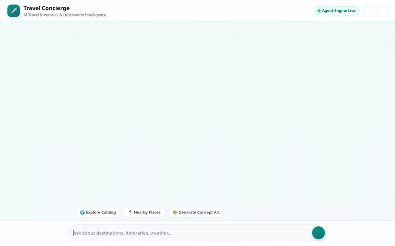

# ✈️ Travel Concierge AI Agent

An intelligent, multimodal AI Travel Concierge built with the Google Agent Development Kit (ADK) and deployed to Agent Engine.



---

## 🌟 Overview

**Travel Concierge AI** helps users discover travel destinations, search destination catalogs, retrieve detailed itineraries, look up real-time weather and currency conversions, discover nearby places, and generate visual artwork and short video previews of travel locations.

---

## 🛠️ Implemented Features & Google Cloud Integrations

The agent integrates the following Google Cloud services and tools:

### 1. 🧠 Persistent Long-Term Memory (Vertex AI Memory Bank)
- **Memory Service**: Wired with Vertex AI Memory Bank (`PreloadMemoryTool` and callback contexts).
- **Cross-Session Recall**: Remembers user preferences, allergies, dietary restrictions, and travel interests across sessions.

### 2. 🗄️ Travel Destination Catalog (Google Cloud Firestore)
- **Catalog Search**: Search destinations by keyword, category, or daily budget limit (`search_destinations`).
- **Destination Details**: Look up full itinerary details for destinations like Tokyo, Kyoto, Paris, or Bali (`get_destination_details`).
- **Add Destinations**: Add custom travel locations directly to the Firestore collection (`add_destination`).

### 3. 🖼️ Multimodal Image & Video Generation (Gemini Models + Google Cloud Storage)
- **Concept Image Generation**: Generates high-quality destination artwork using `gemini-3.1-flash-lite-image` (`generate_destination_image`).
- **Concept Video Generation**: Generates short cinematic travel previews using Google's Omni model `gemini-omni-flash-preview` (`generate_destination_video`).
- **Public Asset Storage**: Stores generated media directly to a public Google Cloud Storage bucket (`travel-concierge-assets-...`).
- **ADK Artifacts**: Saves media as ADK tool artifacts for inspection in dev tools.

### 4. 🎨 Adaptive UI (A2UI Card Renderer)
- **Structured Rendering**: Formats travel search results and destination details into clean, structured A2UI cards (`Card`, `Column`, `Row`, `Text`, `Image`).
- **A2A Protocol**: Communicates via the Agent-to-Agent (A2A) protocol.

### 5. 📍 Location & Places Services (Google Maps APIs)
- **Geocoding**: Converts address names and landmarks into latitude/longitude coordinates (`geocode_address`).
- **Nearby Places Search**: Finds nearby restaurants, attractions, lodging, and parks using Google Places API (`search_nearby_places`).

### 6. 🌐 Real-Time Travel Utilities
- **Live Weather**: Fetches real-time weather conditions and temperatures for any location (`get_weather`).
- **Currency Conversion**: Converts daily travel budgets using live exchange rates (`convert_currency`).
- **World Time**: Provides current local times across international timezones (`get_current_time`).

---

## 🚀 Setup & Local Execution

### Prerequisites
- Python 3.11+
- `uv` package manager installed
- Google Cloud SDK (`gcloud`) authenticated with active project permissions

### 1. Install Dependencies
```bash
uv sync
```

### 2. Seed Firestore Catalog
```bash
uv run python seed_firestore.py
```

### 3. Run Agent Playground Locally
Start the ADK Web Playground locally:
```bash
uv run adk web . --port 8080 --reload_agents
```

### 4. Run Custom Chat Frontend Locally
Navigate to the `frontend/` directory and run the proxy server:
```bash
cd frontend
uv run python main.py
```

---

## 🔮 Planned / Future Features

- ❌ **Flight & Hotel Booking Integration**: Direct booking integration (planned, not yet implemented).
- ❌ **Interactive Itinerary Builder**: Drag-and-drop daily schedule planner (planned, not yet implemented).
